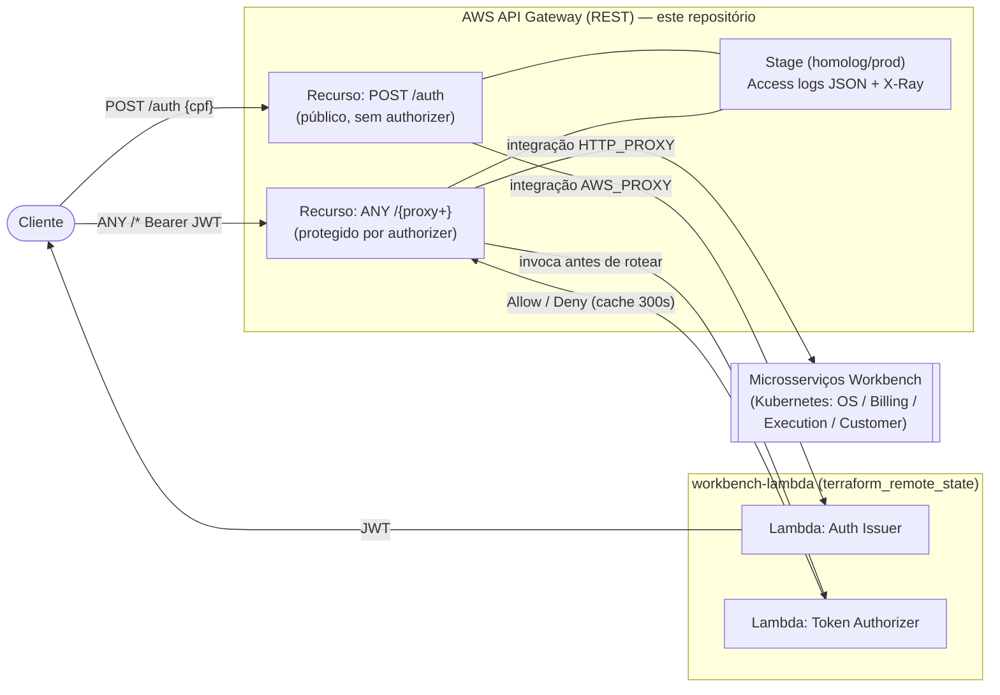

# workbench-gateway

API Gateway da plataforma **Workbench** (FIAP SOAT — Tech Challenge Fase 4).

> **Contexto (Fase 4):** na Fase 3 o gateway encaminhava para o **monólito**. Na
> Fase 4 a aplicação é um conjunto de **microsserviços**; o gateway continua sendo o
> ponto de entrada público (auth + proxy), mas o destino do proxy passou a ser a
> **plataforma de microsserviços** no Kubernetes: cada prefixo de rota é encaminhado
> ao serviço dono (tabela abaixo), não a um backend único.

Provisiona um **AWS API Gateway (REST)** que é o ponto de entrada público da plataforma:

- **`POST /auth`** → encaminhado para a **Lambda issuer (cliente)** (público; emite um JWT a partir do CPF).
- **`POST /auth/login`** → encaminhado para a **Lambda de staff** (`StaffAuthHandler`, público;
  login de staff por e-mail/senha, sem passar pelo authorizer, igual ao `/auth`).
- **`ANY /{proxy+}`** e **`ANY /api/<recurso>/{proxy+}`** → protegidos por um **JWT TOKEN
  authorizer** (a Lambda authorizer) e então encaminhados (HTTP_PROXY por **VPC Link**) ao
  microsserviço dono:

| Rota no gateway | Destino (NLB interno, via VPC Link) |
|---|---|
| `/api/clients/**`, `/api/vehicles/**`, `/api/users/**` | Customer Service |
| `/api/budgets/**`, `/api/payments/**` | Billing Service |
| `/api/products/**`, `/api/stocks/**` | Execution Service |
| todo o resto (`/order/**`, `/service-types/**`, `/monitoring/**`) | OS Service |

O API Gateway escolhe sempre o recurso mais específico, então `/api/<recurso>` vence o
`/{proxy+}` da raiz.

**Os serviços não ficam expostos na internet.** Cada um tem um **NLB interno** (Service
`type: LoadBalancer` com `aws-load-balancer-internal` no `k8s/app.yaml`), alcançável só de
dentro da VPC. O gateway chega até eles por um **VPC Link** por serviço e encontra cada NLB
pela tag `kubernetes.io/service-name` (`terraform/data.tf`) — não há URL de origem para
configurar. Por isso, **os 4 serviços precisam estar no ar antes deste apply**. O mesmo
roteamento existe localmente em
`workbench-messaging/local-gateway/nginx.conf` (`docker compose --profile app`).

As funções Lambda em si vivem no repositório **`workbench-lambda`**; este repositório lê os
ARNs de invocação delas via `terraform_remote_state` e monta o gateway em torno delas.

## Arquitetura



```
POST /auth {cpf}                    -> API Gateway -> Issuer Lambda (cliente) -> JWT
POST /auth/login {email,senha}      -> API Gateway -> Staff Issuer Lambda     -> JWT (staff)
ANY /* (Authorization: Bearer JWT)  -> API Gateway -> Authorizer Lambda (allow/deny)
                                                   -> microsserviços (Kubernetes) se permitido
```

## Tecnologias

- AWS API Gateway (REST), AWS Lambda (referenciada), Terraform (`~> 5.0` AWS provider)
- Logs de acesso estruturados (JSON) no CloudWatch + tracing X-Ray no stage
- GitHub Actions — CI (`terraform fmt`/`validate`) e CD (push para `develop` ou `main`; o nome da branch é o ambiente)

## Referência da API (Swagger / Postman)

Não há um documento OpenAPI gerado para o próprio gateway — ele apenas expõe as rotas
de autenticação e encaminha todo o resto para os microsserviços. Use a collection da
plataforma:

- **Postman:** [`workbench-technical-documentation/postman`](https://github.com/TechChalleng-FIAP-SOAT/workbench-technical-documentation/tree/main/postman)
  (collection unificada + fluxo Saga E2E).
  - `POST {{gatewayUrl}}/auth` → login de cliente (CPF, via Lambda issuer)
  - `POST {{gatewayUrl}}/auth/login` → login de staff (e-mail/senha, via Lambda de staff)
  - demais rotas (`/order`, `/api/clients`, …) → protegidas via `{{gatewayUrl}}` (Bearer JWT)
- **Swagger UI (backend):** `https://<backend>/swagger-ui/index.html`

Aponte `gatewayUrl` para o output `auth_endpoint` (removendo o `/auth` final para obter a base).

## Passos para Execução e Deploy

Pré-requisitos: o stack do `workbench-lambda` precisa estar aplicado antes (seu state
fornece os ARNs de invocação das funções), e a URL da aplicação backend precisa estar acessível.

```bash
cd terraform
cp terraform.tfvars.example terraform.tfvars   # preencha com valores reais

terraform init \
  -backend-config="bucket=<state-bucket>" \
  -backend-config="key=gateway/develop/terraform.tfstate" \
  -backend-config="region=us-east-1"

terraform apply
```

Outputs principais: `auth_endpoint`, `invoke_url`.

## Configuração do CI/CD

Todos vêm de **secrets da organização**, com sufixo por branch (`_MAIN` / `_DEVELOP`) — a
branch é o ambiente:

| Secret | Uso |
|---|---|
| `AWS_ACCESS_KEY_ID_<ENV>`, `AWS_SECRET_ACCESS_KEY_<ENV>`, `AWS_ACCOUNT_ID_<ENV>` | credenciais e guarda de conta do deploy |
| `AWS_REGION` | região (sem sufixo, compartilhada) |
| `TF_STATE_BUCKET_<ENV>` | bucket do state do Terraform |

> Os antigos `ORIGIN_URL*` e `*_ORIGIN_URL*` **não são mais usados**: as origens são os NLBs
> internos, achados pela tag. Pode apagá-los da org.

Chaves de state (mesmo bucket, chaves distintas): este repositório usa `gateway/<env>/terraform.tfstate`
e lê `lambda/<env>/terraform.tfstate`.

No workflow de CD, o deploy do gateway só executa quando o state remoto do Lambda
(`lambda/<env>/terraform.tfstate`) existe no bucket; caso contrário, o job registra
um warning e finaliza sem erro para evitar falha por pré-requisito ausente.

## Ordem de Deploy

```
k8s-terraform -> database -> workbench-lambda -> workbench-gateway -> app
```

## Notes
- The `ANY /{proxy+}` route is guarded by the **JWT authorizer**, which accepts any token
  signed with the shared `JWT_SECRET` (client or staff); the **backend** then enforces roles.
  Staff log in via the public **`POST /auth/login`** on this gateway and call protected routes
  through `/{proxy+}` with their staff JWT. (The backend Swagger UI is still reached directly,
  as it is not exposed as a public gateway route.)
- Protected calls only succeed if the **microsserviços** run the CPF-token filter (grants
  `ROLE_CLIENT`, resolves the client by document via Customer Service). All services share
  the same `JWT_SECRET`, so a token is verifiable across the platform.
- The authorizer keeps a 300s result cache; the authorizer Lambda returns a stage-wide Allow
  (`…/<stage>/*/*`) so caching does not break multi-route sessions.
- Access logs are JSON in CloudWatch (`/aws/apigateway/<api>-<env>/access`) with `requestId`
  for correlation with the Lambda logs.
- Remember to add the **`soat-architecture`** user to this repository.
